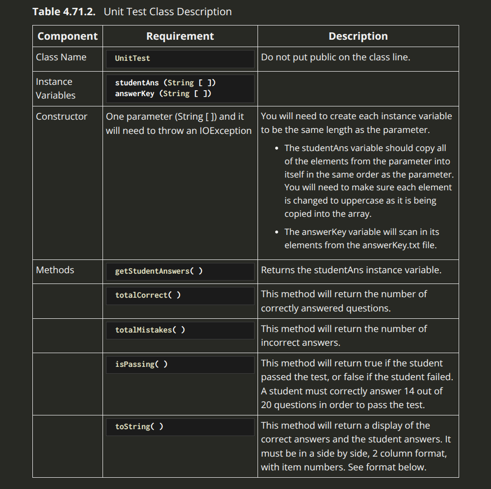

# Unit Test

Write a program that will grade a multiple choice test. This program will contain two classes: Main and UnitTest. You are to code the UnitTest class first as described below:


Example output from the toString method (remember to return the String, not print it):

```
ANSWER KEY 	Student's Answers
1) B 			1) A
2) D 			2) A
3) C 			3) C
.			.
. 			.
. 			.
20) E 			20) A
```

**Hint for the toString method**: Create a String and initialize it to the first line of the output using a tab between the phrases instead of spaces (\t). Create another String for the rest of your output, initializing it to the empty String. Use a for loop to concatenate onto that string the problem number (which should be one more than the index number) and the String from each array at that index with tabs between the correct answer and the student’s answer (two tabs should do it - \t\t). Return the first String, followed by a new line (\n), followed by the second String.

Once the UnitTest class is complete, you are to complete the Main class to test your UnitTest class as follows:

In the main method,
- Create a String array called answerArray of size 20.
- Create a Scanner object.
- Use a for loop to allow the user to enter their answers one at a time until they have entered all 20 answers. Store these into the answerArray as they enter them. It should not matter if they enter upper or lower case letters.
- Create a UnitTest object using the array of answers as the parameter.
- Display the following information:
  - The correct answers and student’s answers using the toString method.
  - Number of Correct Answers: ___ (the blank should be filled in with the appropriate value returned from the appropriate method).
  - Number of Mistakes: ___ (the blank should be filled in with the appropriate value returned from the appropriate method).
  - Display either “The student PASSED” or “The student FAILED” as determined by the appropriate method.

